<h1 align="center">Hi there, I'm Optiblur 👋</h1>

  

  
  

---

### 🧑‍💻 About me

- 🔐 Learning software development with a focus on **cybersecurity**
- 📚 Currently learning **cryptography fundamentals**, **secure randomness** and **password entropy**
- 🎮 I run a Minecraft server — and fix its problems by writing my own plugins
- 🌱 I learn best by building things I actually need

---

### 🚀 Projects

  
  

#### 🔑 [PassForge](https://github.com/Optiblur/pass-forge) — *main project*
A C# / WinForms password & PIN generator built with security in mind:
- cryptographically secure random generation (**CSPRNG**) instead of `System.Random`, so passwords can't be predicted
- **rejection sampling** to avoid modulo bias — every character is equally likely
- **input validation** and **unit tests**

#### 🗺️ [ImageOnMapReborn](https://github.com/Optiblur/ImageOnMapReborn) — *side project*
A small passion project born out of a real need: the plugin I used on my Minecraft server (ImageOnMap) stopped being updated in 2021, so I rewrote it from scratch.
- puts pictures from the Internet onto in-game maps
- same commands & permissions as the original — a **drop-in replacement**
- **automatically imports all old maps** on first start, nothing gets lost
- supports Paper / Purpur / Spigot **1.20.1 and newer**

---

### 🛠️ Tech stack

**Languages**
 

**Frameworks & platforms**
 

**Tools**
 

---

### 📊 GitHub stats

  
  

---

<i>Always learning, always building. 🛠️</i>

